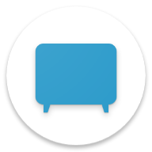
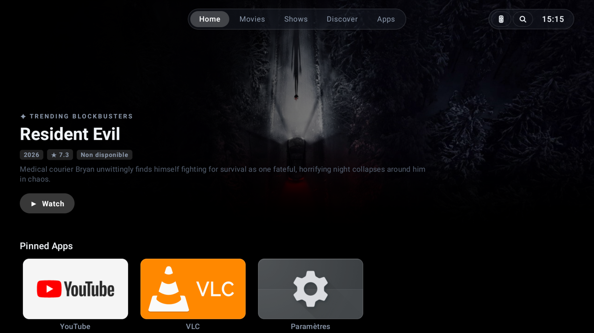

#  Abyss TV Launcher

<div align="center">
    
</div>

<p align="center">
    A fast, bloat-free launcher for Android TV with native Jellyfin and Jellyseerr integration.
</p>

---

## ✨ Features

- **Modern TV Design**: Grouped container cards, ice-blue focus states, smooth D-pad navigation, and Google TV style sidebar drawer.
- **NVIDIA Shield TV Shortcut**: Dedicated shortcut button to trigger the Shield Remote Locator directly from top navigation.
- **Native Jellyfin Client**: Resume watchlist, Next Up episode tracking, instant ExoPlayer playback, and watch status sync.
- **Jellyseerr / Overseerr Discovery**: Browse trending media, monitor active downloads, and send media requests directly from your TV.
- **Built-in Media3 Player**: Full 10-foot player with audio and subtitle tracks selectors, plus rapid D-pad seek accumulation.
- **App Drawer & Customization**: Pin, reorder, or hide installed apps with a simple long-press context menu.
- **Native Localization**: French and English localization using standard Android resources and system locales.
- **Zero Ads & Zero Telemetry**: Clean interface without sponsored banners or background bloatware.

---

# 🚀 Getting Started

## Step 1: Prerequisites

- Android SDK 35 (Android 15) with Build Tools 35.0.0
- Java 17+ & Gradle 8.11+
- Android TV / Google TV device running Android 9.0+ (API 28+) connected via ADB

## Step 2: Build and Install

1. Clone repository:
   ```bash
   git clone https://github.com/DylanAkp/Abyss-Launcher.git
   cd Abyss-Launcher
   ```

2. Compile release APK (recommended for maximum 60fps performance):
   ```bash
   ./gradlew assembleRelease
   ```

3. Sideload onto Android TV device over ADB:
   ```bash
   adb connect <TV_IP_ADDRESS>:5555
   adb install -r app/build/outputs/apk/release/app-release.apk
   ```

## Step 3: Set as Default Launcher (Disable Stock Launcher)

To make Abyss TV Launcher your primary home screen on your TV, disable the stock launcher over ADB:

### For Android TV (e.g. NVIDIA Shield TV, Xiaomi Mi Box, Sony Android TV):
```bash
adb shell pm disable-user --user 0 com.google.android.tvlauncher
```

### For Google TV (e.g. Chromecast with Google TV):
```bash
adb shell pm disable-user --user 0 com.google.android.apps.tv.launcherx
```

Press the **Home** button on your remote — Abyss TV will now open automatically as default.

---

# 🔄 Uninstall & Restore Stock Launcher

If you ever want to revert back to the stock home screen:

1. Re-enable the default launcher via ADB:
   ```bash
   # For Android TV (NVIDIA Shield, etc.)
   adb shell pm enable com.google.android.tvlauncher

   # For Google TV
   adb shell pm enable com.google.android.apps.tv.launcherx
   ```

2. Uninstall Abyss TV Launcher:
   ```bash
   adb uninstall dev.dylanakp.abysstvlauncher
   ```

---

# 🤝 Contributing

We welcome contributions to Abyss TV Launcher! When submitting changes, please follow these commit guidelines:

## Commit Message Format

Each commit message should follow this format:

1. **Headline**: A one-line summary of the change (50 characters maximum)
   - Use prefixes to describe the area changed (e.g., `UI`, `Player`, `Jellyfin`, `Seer`, `Build`, `Data`)
   - Example: `UI: Align settings drawer with grouped cards`

2. **Body**: If needed, a detailed description that hard-wraps at 72 characters
   - Explain what issue the change solves and how
   - Include any important assumptions or background context

For more information on writing good commit messages, check out [How to Write a Git Commit Message](https://cbea.ms/git-commit/).

---

# 🙌 Credits

- [AndroidX Media3](https://github.com/androidx/media) for the video playback stack
- [Jetpack Compose](https://developer.android.com/jetpack/compose) for modern TV UI rendering
- [Jellyfin](https://jellyfin.org/) for media server API specifications
- [Jellyseerr](https://github.com/Fallenbagel/jellyseerr) & [Overseerr](https://overseerr.dev/) for request management APIs
- [Coil](https://coil-kt.github.io/coil/) for image loading with BlurHash support

---

# 📜 Licenses

- **Abyss TV Launcher**: [MIT License](LICENSE)
- **Jetpack Compose / Media3**: [Apache License 2.0](https://www.apache.org/licenses/LICENSE-2.0)
- **Material Icons**: [Apache License 2.0](https://www.apache.org/licenses/LICENSE-2.0)

---

# ⚠️ Disclaimer

This project and its contents are not affiliated with, funded, authorized, endorsed by, or in any way associated with Google LLC, NVIDIA, Android TV, Jellyfin, Jellyseerr, or Overseerr.

Any trademark, service mark, trade name, or other intellectual property rights referenced are the property of their respective owners.

---

## LLM Usage

_This project has been made to fill my needs of a fast, bloatware-free TV launcher for Android TV with native Jellyfin & Jellyseerr integration, and some code were made with the help of Large Language Models to assist in development._
